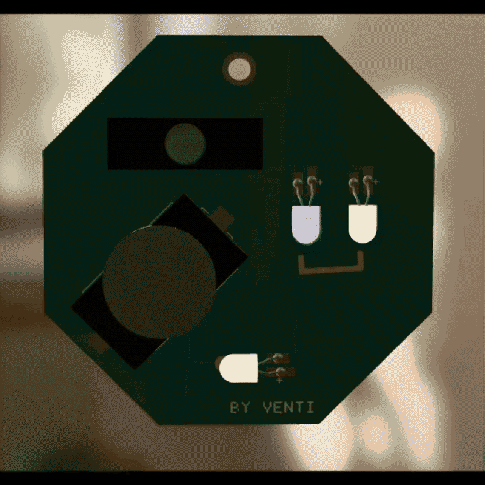
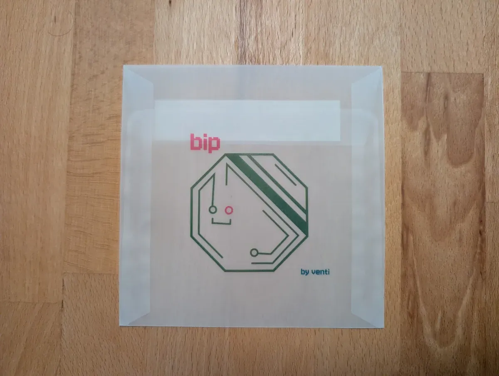
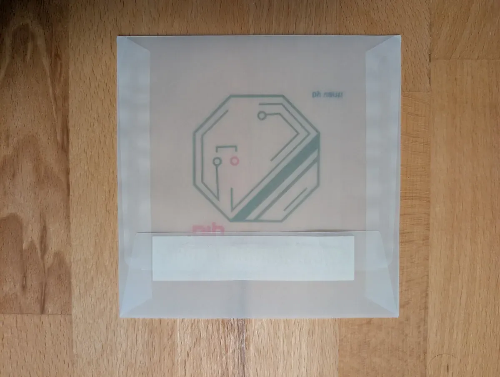
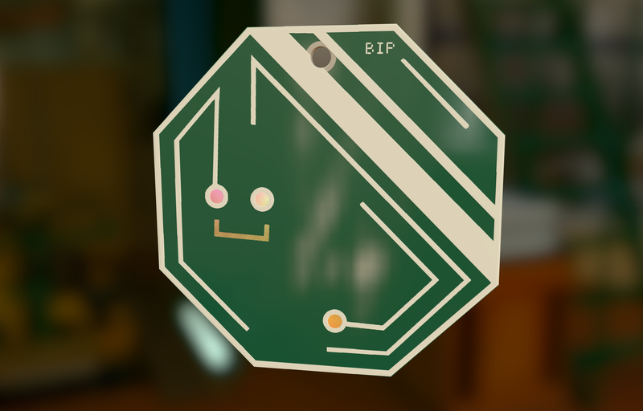
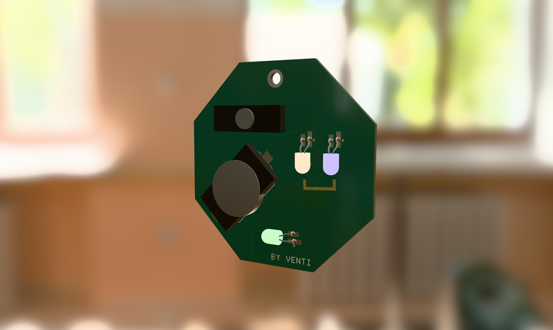

# BIP

  

## A 40C3 CHARACTER, REIMAGINED AS A PCB

BIP is a character from the [40C3 style guide](https://events.ccc.de/congress/2026/infos/styleguide/), reincarnated as a 70 x 70 mm PCB.

Solder kits will be available at 40C3 at the [Binary Kitchen assembly](https://www.binary-kitchen.de/).

Designed with [Alber PCB Designer](https://alber.me/miscellaneous/tools/pcb-designer.html), this project includes the tool's [`bip-project.json`](./bip-project.json), KiCad exports, fabrication files, visual assets, and an interactive BOM.

## BOARD AT A GLANCE

- 70 x 70 mm PCB outline
- Green soldermask and white silkscreen styling
- JLCPCB-ready manufacturing metadata and board setup
- KiCad source project plus generated Gerber outputs
- Interactive assembly review with the HTML BOM

## PROJECT FILES

- [Interactive BOM](./ibom.html)
- [Full board render](./bip-view.png)
- [KiCad project](./bip-kicad/)
- [Gerber package](./bip-gerber.zip)
- [KiCad bundle archive](./bip-kicad.zip)
- [PCB metadata](./bip-project.json)
- [Vector artwork](./bip.svg)
- [Small PNG artwork](./bip-icon.png)
- [Animation preview](./bip.mp4)
- [Envelope print file](./bip_125mm_envelope.pdf)
- [Packaging photo 1](./bip-packaging-1.webp)
- [Packaging photo 2](./bip-packaging-2.webp)

## IN THIS DIRECTORY

This directory contains the canonical design source and the exported deliverables for the BIP board:

- `bip-kicad/` holds the editable KiCad project files.
- `ibom.html` is the interactive BOM view for checking component placement and values.
- `bip-gerber.zip` contains the manufacturing Gerber files.
- `bip-project.json` captures the board metadata and manufacturing setup.
- `bip-view.png`, `bip-view-thumb.png`, and `bip-view-backside-thumb.png` provide render previews for documentation and presentation.
- `bip.svg`, `bip-icon.png`, `bip.mp4`, `bip-loop.gif`, the two `bip-packaging-*.webp` photos, and `bip_125mm_envelope.pdf` provide additional visual and print assets.

The [BIP vector artwork](./bip.svg) is used as a visual accent in this README.

## DESIGN WORKFLOW

The [KiCad project files](./bip-kicad/) are available for inspection and downstream use. For design iteration, use the [Alber PCB Designer](https://alber.me/miscellaneous/tools/pcb-designer.html) with the included [`bip-project.json`](./bip-project.json); the KiCad files are an export, not the source workflow. Open the [interactive BOM](./ibom.html) to inspect component placement and values. For fabrication, use the generated Gerber package or the bundled archive alongside the board metadata file.

## LICENSE

The original hardware design files are licensed under [CC BY-NC-SA 4.0](./LICENSE.md).

## PACKAGING

A semi transparent envelope 125mm x 125mm

  
  

